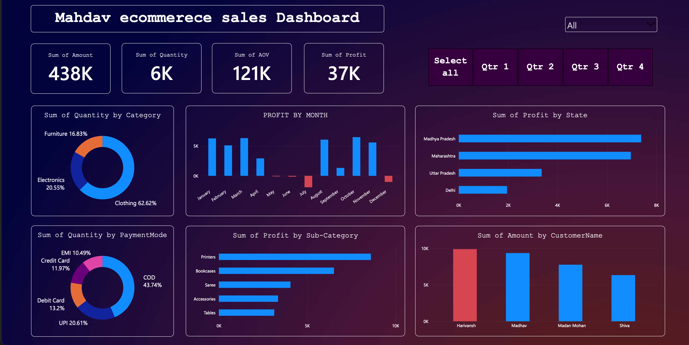

# Mahdav Store — Power BI Sales Dashboard

## Dashboard Preview

## Project Overview
Mahdav Store is a sales analytics project developed using Microsoft Power BI. The project presents sales data through an interactive dashboard to support business reporting and decision-making.

## Tools & Technologies
- Microsoft Power BI
- Power Query for data transformation
- DAX for measures and calculations

## Project Files
- `Mahdav Store.pbit` — Power BI template file
- 'dashboard.png' - Power BI Dashboard Screenshot

## Key Objectives
- Analyze sales performance and business trends
- Present key performance indicators through visualizations
- Enable users to explore business data interactively

## How to Use
1. Download the `.pbit` file from this repository.
2. Open it in Microsoft Power BI Desktop.
3. Interact with the report using the available filters and visualizations.
